<picture>
  <source media="(prefers-color-scheme: dark)" srcset="./docs/assets/header-dark.svg">
  <source media="(prefers-color-scheme: light)" srcset="./docs/assets/header-light.svg">
  
</picture>

<p align="center">
  
  
  
  
</p>

**A Flappy Bird clone in C++17 and SFML.** This was the final project for *Computer Programming 4* at the Silesian University of Technology. The brief was a complete game built around object-oriented design patterns, so beyond the gameplay, the point of the code is its structure: a singleton game loop, a state machine, a pipe factory, polymorphic menus and power-ups, and textures loaded on background threads.

## 🎮 Gameplay

- **Space** flaps, gravity does the rest. Fly through the gaps and every pipe you pass scores a point.
- **Moving pipes** show up every few points. Their gap slides up and down, so timing matters more.
- **It gets harder:** every 10 points the pipes move faster, sit closer together, and the moving ones swing further.
- **Invincibility gem:** every 20 seconds a gem floats in. Grab it and you can fly through pipes for 7 seconds (the bird turns translucent).
- Mouse-driven menus: start, pause/resume, game over with restart or back to menu.
- **Esc** quits and **F12** saves a `screenshot.png`.

## 🧩 Architecture

```text
main.cpp ──► Game (singleton) ── update(dt) / render() every frame, capped at 90 FPS
              │
              ├─ GameState      LOADING → MENU → PLAYING ⇄ PAUSE → GAME_OVER
              ├─ TextureManager async loading, one thread per texture, guarded by a mutex
              ├─ PipeFactory    decides Pipe vs MovingPipe and scales difficulty with the score
              ├─ Bird           frame-rate independent physics, 3-frame flap animation, tilt
              ├─ PowerUp        ◄─ Invincibility
              ├─ Pipe           ◄─ MovingPipe
              └─ Menu           ◄─ MainMenu · GamePlayMenu · PauseMenu · GameOverMenu (built from UIButtons)
```

| Pattern / technique | Where | What it does |
|---|---|---|
| Singleton | `Game::getInstance()` | one window and one game loop, copy and assignment deleted |
| State machine | `GameState`, `Game::update` / `render` | each state has its own update and render path |
| Factory | `PipeFactory::createPipe(score)` | returns `std::unique_ptr<Pipe>`, which may be a `MovingPipe`, and tunes speed, spacing and range from the score |
| Polymorphism | `Pipe`, `PowerUp`, `Menu` | virtual `update` / `render` / `apply`, so the game stores base-class pointers |
| Concurrency | `TextureManager` | textures load on detached threads while a centered *Loading* screen is shown; `GameState::LOADING` waits until all of them are in |
| Validation | `PathValidator` | `std::filesystem` and regex checks on every asset path and extension before loading |

**Collisions:** the bird's hitbox is shrunk before testing against the pipes and the ground. Rotating a sprite inflates its axis-aligned bounding box, and without the shrink the bird would "hit" pipes it visibly missed.

## 🚀 Build & run

You need CMake 3.16+ and a C++17 compiler. If SFML 2.6 is installed on your system CMake uses it; otherwise it downloads and builds SFML 2.6.1 automatically.

```bash
cmake -S . -B build -DCMAKE_BUILD_TYPE=Release
cmake --build build --config Release
./build/flappy_bird            # Windows: build\Release\flappy_bird.exe
```

The build copies `assets/` next to the executable, so it runs straight from the build folder. In Visual Studio, use *Open → Folder* (CMake support) and press F5. The debugger's working directory is already set.

On Linux, the system package works too: `sudo apt install libsfml-dev` (Ubuntu 24.04 and later ship 2.6).

## 🗂️ Repository

```
src/          game sources (Game, Bird, Pipe, PipeFactory, menus, TextureManager, ...)
assets/       textures and font used by the game
docs/assets/  README graphics
```

## ⚠️ Assets

Flappy Bird is © .GEARS Studios / Dong Nguyen. The sprites in `assets/textures/` are Flappy Bird style game assets, used here only in a non-commercial university project. All rights belong to their original authors. The README header is original vector art and does not use them.
